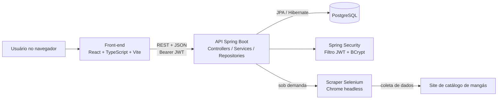
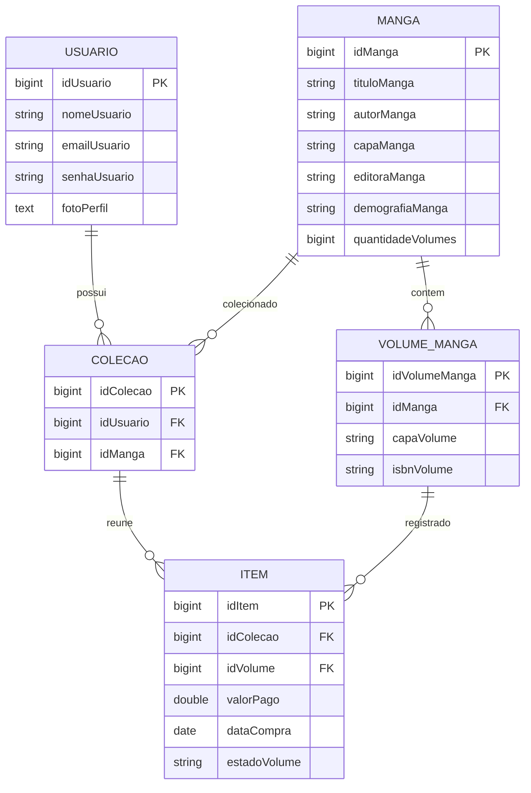
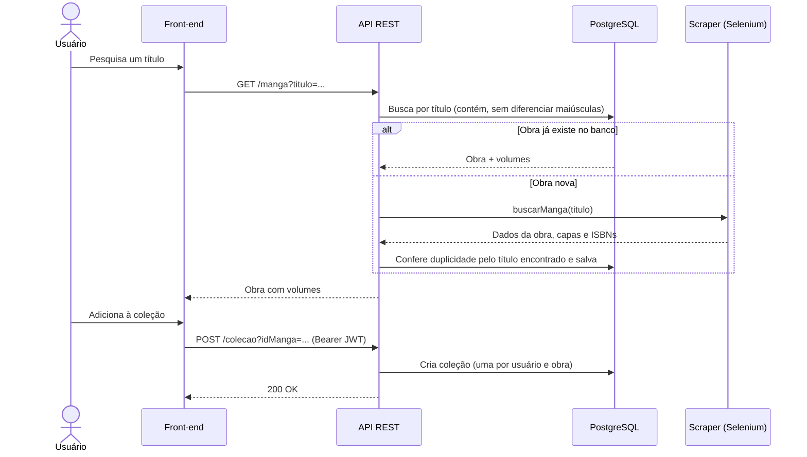

# MangaSensei

> Aplicação web para quem coleciona mangá físico: pesquise obras, monte suas coleções e acompanhe o progresso de cada uma.


## Sumário

- [Visão geral](#visão-geral)
- [Funcionalidades e casos de uso](#funcionalidades-e-casos-de-uso)
- [Arquitetura](#arquitetura)
- [Coleta automática de dados (scraper)](#coleta-automática-de-dados-scraper)
- [Modelo de domínio](#modelo-de-domínio)
- [Pré-requisitos](#pré-requisitos)
- [Configuração e execução local](#configuração-e-execução-local)
- [API](#api)
- [Fluxo de pesquisa de uma obra](#fluxo-de-pesquisa-de-uma-obra)
- [Estrutura do projeto](#estrutura-do-projeto)
- [Segurança e configuração](#segurança-e-configuração)
- [Observações técnicas e limitações](#observações-técnicas-e-limitações)
- [Roadmap](#roadmap)
- [Autor](#autor)

## Visão geral

Quem coleciona mangá físico costuma controlar tudo de cabeça ou em planilhas: quais séries acompanha, quantos volumes já tem e quanto falta. O MangaSensei centraliza isso em uma aplicação web composta por uma interface em React e uma API REST em Spring Boot.

Um diferencial do projeto é que o catálogo **se alimenta sozinho**: quando o usuário pesquisa uma obra que ainda não está no banco, a API aciona um scraper (Selenium) que busca os dados em um site de catálogo, salva no PostgreSQL e devolve o resultado. Nas próximas pesquisas, a obra já vem direto do banco.

## Funcionalidades e casos de uso

| Área | Casos de uso disponíveis |
| --- | --- |
| Conta | **UC01** cadastrar usuário (nome, e-mail e senha de no mínimo 8 caracteres); **UC02** entrar com e-mail e senha e receber um token JWT; **UC04** alterar nome, e-mail, senha e foto de perfil. |
| Catálogo | **UC06** pesquisar mangá por título (com coleta automática quando a obra não existe no banco); **UC07** explorar mangás agrupados por demografia (shounen, seinen etc.), com seleção aleatória a cada consulta. |
| Coleções | **UC08** criar a coleção de uma obra (uma por mangá por usuário); **UC09** listar as coleções com a quantidade de volumes possuídos e o percentual concluído; **UC10** remover uma coleção (apenas o dono pode). |
| Interface | Login e cadastro, tela inicial, exploração, pesquisa, coleção, configurações de perfil e rotas protegidas por token. Uma tela de marketplace aparece como "em breve". |

O percentual de uma coleção é calculado no back-end: volumes possuídos da coleção divididos pela quantidade total de volumes da obra.

## Arquitetura



O front-end concentra telas e navegação; a camada `src/service` centraliza as chamadas HTTP em um único cliente (`apiRequest`), que anexa o token e trata sessão expirada (401). A API segue separação em camadas: controllers recebem as requisições, services executam as regras de negócio e repositories acessam os dados via Spring Data JPA.

### Tecnologias

- **Front-end:** React 19, TypeScript, Vite, React Router e React Icons.
- **Back-end:** Java 21, Spring Boot 3.5, Spring Web, Spring Security, Spring Data JPA, Lombok e spring-dotenv.
- **Persistência:** PostgreSQL com Hibernate/JPA.
- **Autenticação:** token JWT (HMAC-SHA256) e senhas codificadas com BCrypt.
- **Automação:** Selenium WebDriver 4 e WebDriverManager (Chrome headless).

## Coleta automática de dados (scraper)

A classe `ScraperManga` (Java + Selenium) abre o Chrome em modo headless, pesquisa o título em um site de catálogo, abre a página da coleção e extrai:

- título, autor, editora e demografia da obra;
- capa da obra e quantidade de volumes;
- capa e **ISBN** de cada volume.

O `WebDriverManager` baixa e gerencia o chromedriver automaticamente, então não é preciso configurar o caminho manualmente. Antes de salvar, o service confere o banco de novo usando o título encontrado pelo scraper, para evitar obras duplicadas.

> O scraper depende da estrutura HTML do site de origem, que pode mudar. Use-o apenas para fins de estudo e respeite os termos de uso do site consultado.

Uma versão independente em Python desse tipo de coleta está no repositório [ScrapingManga](https://github.com/LucasIberDias/ScrapingManga).

## Modelo de domínio



Regras de integridade: cada usuário tem no máximo uma coleção por mangá (`idUsuario` + `idManga` únicos) e um volume só pode aparecer uma vez em cada coleção (`idColecao` + `idVolume` únicos). Os nomes físicos de tabelas e colunas seguem a estratégia de nomenclatura do Spring/Hibernate; confira o schema criado antes de executar SQL manual.

## Pré-requisitos

- Java 21.
- Node.js compatível com Vite 8 e npm.
- PostgreSQL acessível.
- Google Chrome instalado (usado pelo scraper).

## Configuração e execução local

### 1. Clone o repositório

```bash
git clone https://github.com/LucasIberDias/Manga-Sensei.git
cd Manga-Sensei
```

### 2. Crie o banco

```sql
CREATE DATABASE "MangaSensei";
```

As tabelas são criadas e atualizadas automaticamente pelo Hibernate (`spring.jpa.hibernate.ddl-auto=update`).

### 3. Configure as credenciais

A configuração padrão está em `back-end/src/main/resources/application.properties` (banco `MangaSensei` em `localhost:5432`). Em vez de editar o arquivo com suas credenciais, sobrescreva por variáveis de ambiente, que têm prioridade. Exemplo no PowerShell:

```powershell
$env:SPRING_DATASOURCE_URL = "jdbc:postgresql://localhost:5432/MangaSensei"
$env:SPRING_DATASOURCE_USERNAME = "postgres"
$env:SPRING_DATASOURCE_PASSWORD = "sua_senha_local"
$env:JWT_SECRET = "substitua_por_uma_chave_aleatoria_com_mais_de_32_bytes"
```

No Linux ou macOS, use `export NOME="valor"`. O `JWT_SECRET` precisa ter pelo menos 32 bytes; sem ele, a API usa uma chave de desenvolvimento que **não deve ser usada em produção**.

### 4. Inicie a API

```powershell
cd back-end
.\mvnw.cmd spring-boot:run
```

No Linux ou macOS: `./mvnw spring-boot:run`. A API sobe na porta `8080`.

### 5. Inicie a interface

Em outro terminal:

```bash
cd front-end
npm install
npm run dev
```

A aplicação abre em `http://localhost:5173`, que é a origem liberada no CORS da API. Para apontar para outra URL de API, crie `front-end/.env` com `VITE_API_URL=http://localhost:8080`.

### Scripts disponíveis

| Diretório | Comando | Finalidade |
| --- | --- | --- |
| `front-end` | `npm run dev` | Inicia o servidor de desenvolvimento Vite. |
| `front-end` | `npm run build` | Verifica os tipos TypeScript e gera o build de produção. |
| `front-end` | `npm run lint` | Executa o ESLint. |
| `front-end` | `npm run preview` | Serve localmente o build do Vite. |
| `back-end` | `./mvnw spring-boot:run` | Inicia a API com o Maven Wrapper. |
| `back-end` | `./mvnw test` | Executa os testes do back-end. |

## API

A base local padrão é `http://localhost:8080`. As rotas marcadas como **pública** não exigem token; as demais exigem `Authorization: Bearer <token>`.

| Método | Rota | Acesso | Descrição |
| --- | --- | --- | --- |
| `POST` | `/usuario` | pública | Cadastra usuário (nome, e-mail e senha). |
| `POST` | `/auth/login` | pública | Autentica e devolve o token JWT e os dados do usuário. |
| `PATCH` | `/usuario` | JWT | Altera nome, e-mail, senha ou foto de perfil do usuário autenticado. |
| `GET` | `/manga?titulo={titulo}` | pública | Pesquisa uma obra; se não existir no banco, aciona o scraper e salva o resultado. |
| `GET` | `/manga/demografia` | pública | Lista mangás agrupados por demografia. |
| `POST` | `/colecao?idManga={id}` | JWT | Cria a coleção de uma obra para o usuário autenticado. |
| `GET` | `/colecao` | JWT | Lista as coleções do usuário com volumes possuídos e percentual. |
| `DELETE` | `/colecao?idColecao={id}` | JWT | Remove uma coleção (somente do próprio usuário). |

Exemplo de login:

```http
POST /auth/login
Content-Type: application/json
```

```json
{
  "emailUsuario": "usuario@exemplo.com",
  "senhaUsuario": "sua-senha-com-8-ou-mais-caracteres"
}
```

Exemplo de resposta de `GET /colecao`:

```json
[
  {
    "idColecao": 1,
    "idManga": 10,
    "tituloManga": "Título da obra",
    "autorManga": "Autor",
    "capaManga": "https://...",
    "demografiaManga": "Shounen",
    "quantidadeVolumes": 20,
    "volumesPossuidos": 5,
    "porcentagem": 25
  }
]
```

## Fluxo de pesquisa de uma obra



## Estrutura do projeto

```text
MangaSensei/
├── back-end/
│   ├── pom.xml
│   └── src/main/
│       ├── java/MangaSensei/
│       │   ├── config/       # JWT, filtro de autenticação, segurança, CORS e senha
│       │   ├── controller/   # Endpoints REST
│       │   ├── dto/          # Contratos de entrada e saída
│       │   ├── model/        # Entidades JPA
│       │   ├── repository/   # Acesso a dados
│       │   ├── script/       # Scraper Selenium e tratamento global de exceções
│       │   └── service/      # Regras de negócio
│       └── resources/        # application.properties e imagem de perfil padrão
└── front-end/
    ├── package.json
    └── src/
        ├── app/              # Rotas protegidas por token
        ├── assets/           # Identidade visual
        ├── components/       # Componentes compartilhados
        ├── pages/            # Telas por domínio (auth, collection, dashboard, manga, marketplace, profile)
        ├── service/          # Cliente HTTP e integração com a API
        ├── styles/           # Estilos globais
        └── types/            # Tipos TypeScript
```

## Segurança e configuração

- O cadastro e o login são públicos; as rotas de coleção e de perfil exigem token JWT válido.
- Os tokens são assinados com HMAC-SHA256 usando `app.jwt.secret` (variável `JWT_SECRET`) e expiram em 8 horas.
- Senhas são armazenadas com BCrypt; a API nunca devolve o hash.
- Cada coleção só pode ser removida pelo seu dono (acesso negado caso contrário).
- A foto de perfil aceita apenas imagens em data URL de até cerca de 1 MB.
- O CORS está liberado somente para `http://localhost:5173`; ajuste a origem ao publicar em outro domínio.
- O front-end guarda a sessão em `localStorage`. Em produção, avalie o modelo de armazenamento mais adequado à sua política de segurança.

## Observações técnicas e limitações

- **JWT próprio:** a emissão e a validação do token foram implementadas manualmente com `javax.crypto` (HMAC-SHA256), como exercício. Em produção, o recomendado é usar uma biblioteca consolidada.
- **Rotas de catálogo públicas:** `/manga/**` não exige autenticação, e a pesquisa de uma obra nova dispara o scraper. Antes de expor a API publicamente, proteja ou limite essas rotas.
- **Volumes ainda não registráveis:** a entidade `Item` (valor pago, data da compra e estado do volume) já está modelada, mas a API ainda não expõe endpoints para registrá-los. Por isso, o percentual de cada coleção fica em 0% até essa etapa ser concluída (veja o [Roadmap](#roadmap)).
- **Scraper frágil por natureza:** depende do HTML do site de origem e do Chrome instalado na máquina.
- **Sem migrações versionadas:** o schema é gerenciado por `ddl-auto=update`; não use essa estratégia em produção.
- **Testes:** o repositório tem apenas o teste de carregamento de contexto do Spring.

## Roadmap

- [ ] Endpoints e tela para registrar volumes da coleção (valor pago, data de compra e estado)
- [ ] Marketplace para troca e venda de volumes entre colecionadores
- [ ] Testes automatizados (JUnit e Mockito no back-end)
- [ ] Migrações de banco com Flyway
- [ ] Proteção e cache das rotas de catálogo (rate limit) e fila para o scraper
- [ ] Documentação OpenAPI/Swagger
- [ ] Docker Compose (API, front-end e PostgreSQL) e deploy online

## Autor

**Lucas Iber Dias**, estudante de Análise e Desenvolvimento de Sistemas no IFPR.

[](https://www.linkedin.com/in/lucasiberdias)
[](https://github.com/LucasIberDias)

---

<p align="center">MangaSensei · Gestão de coleções de mangá</p>
